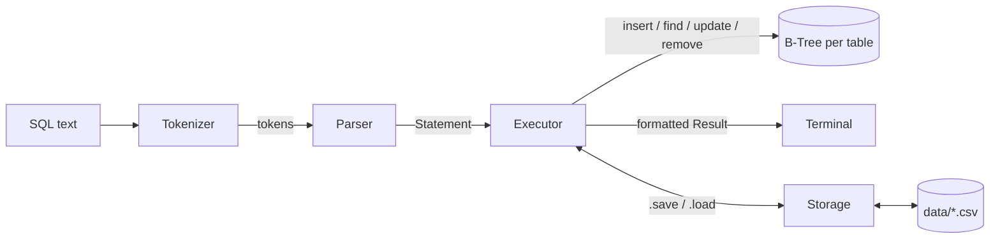
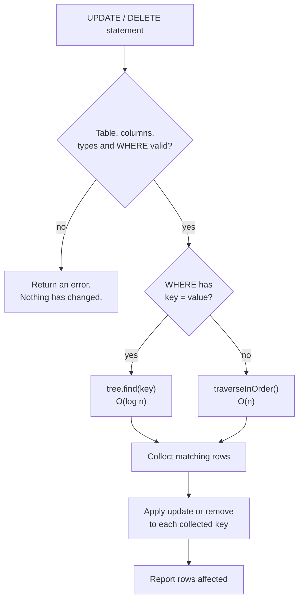
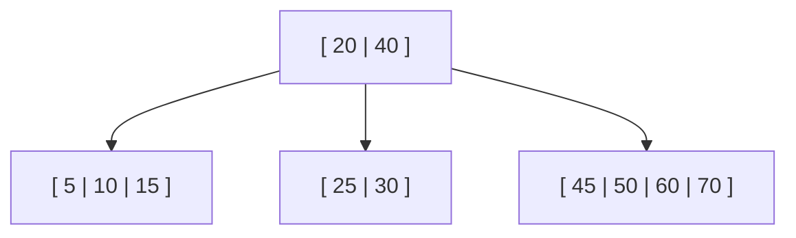

# MiniDB

MiniDB is a small file-backed database written from scratch in C++17. It stores each table in a hand-written B-Tree, saves tables to CSV files, and lets you work with your data through a SQL prompt. It uses no external libraries and no database engine. Everything from the tokenizer to the B-Tree rebalancing is our own code.

We built it as our semester project for CSC 307 Data Structures and Algorithm Analysis (Fall 2025, group H001G07). The proposal asked for a key-value store with an in-memory B-Tree index, CSV persistence and a command-line interface. We kept that core and put a small SQL layer on top, so the same B-Tree operations run behind `INSERT`, `SELECT`, `UPDATE` and `DELETE`.

```
db > CREATE TABLE players (id INT, name TEXT, score INT);
Table players created
db > INSERT INTO players VALUES (1, 'Linus', 1200);
1 row inserted
db > INSERT INTO players VALUES (2, 'Bjarne', 950);
1 row inserted
db > SELECT name, score FROM players WHERE score > 900 ORDER BY score DESC;
+----------+-------+
| name     | score |
+----------+-------+
| Linus    |  1200 |
| Bjarne   |   950 |
+----------+-------+
(2 rows)
db > .save
Saved 1 table to data
```

## Quick start

You need `g++` or `clang++` with C++17 support, and `make`.

```bash
git clone https://github.com/eclipsu/minidb.git
cd minidb
make          # builds ./minidb
./minidb
```

Type SQL at the `db >` prompt, and end each statement with a semicolon. The up and down arrows go through your command history.

## Commands

### SQL

```sql
CREATE TABLE users (id INT, name TEXT, age INT);
INSERT INTO users VALUES (1, 'bob', 20);
SELECT * FROM users;
SELECT name, age FROM users WHERE age > 18 AND (name = 'bob' OR id = 2) ORDER BY age DESC;
UPDATE users SET age = 21 WHERE id = 1;
DELETE FROM users WHERE id = 1;
TRUNCATE TABLE users;
DROP TABLE users;
```

There are two column types, `INT` and `TEXT`. The first column of every table is its key. Keys must be unique, and the key can't be changed with `UPDATE`. To change a key, delete the row and insert it again.

`WHERE` supports `=`, `!=`, `<`, `>`, `<=`, `>=`, `AND`, `OR` and parentheses. `ORDER BY` takes one or more columns, each with an optional `ASC` or `DESC`. It can sort by a column you didn't select.

### Dot commands

| Command       | What it does                                                                    |
| ------------- | ------------------------------------------------------------------------------- |
| `.tables`     | Lists every table and how many rows it has.                                     |
| `.save [dir]` | Writes every table to `<dir>/<table>.csv`. The default folder is `data`.        |
| `.load [dir]` | Replaces the tables in memory with the CSV files in `<dir>`.                    |
| `.exit`       | Quits. If you have unsaved changes, it asks whether to save, discard or cancel. |

Whatever folder you pass to `.save` or `.load` becomes the default for the rest of the session.

## How the proposal maps to MiniDB

| Proposal command | In MiniDB                            | B-Tree operation                |
| ---------------- | ------------------------------------ | ------------------------------- |
| ADD              | `INSERT INTO t VALUES (...)`         | `insert(key, row)`              |
| GET              | `SELECT * FROM t WHERE key = k`      | `find(key)`                     |
| LIST             | `SELECT * FROM t`                    | `traverseInOrder()`             |
| UPDATE           | `UPDATE t SET col = v WHERE key = k` | `update(key, row)`              |
| DELETE           | `DELETE FROM t WHERE key = k`        | `remove(key)`                   |
| SAVE             | `.save`                              | `traverseInOrder()`, then write |
| LOAD             | `.load`                              | builds a new tree per table     |
| EXIT             | `.exit`                              | asks before losing changes      |

MiniDB also covers the error cases the proposal asked us to define:

- **Duplicate keys** are rejected, and the existing row is left alone.
- **A missing key** in `UPDATE` or `DELETE` affects 0 rows. It is not an error.
- **Memory** is freed when a table goes away. The `BTree` destructor frees every node, and each table is owned by a `std::unique_ptr`, so `DROP`, `TRUNCATE` and `.load` free the old tree. The ASan test build checks this.
- **Saving is explicit.** MiniDB never saves on its own, and `.exit` asks before it throws changes away.

## Architecture



1. **Tokenizer** (`src/tokenizer.cpp`) turns the input string into tokens such as `SELECT`, `IDENTIFIER(users)`, `>` and `NUMBER(18)`.
2. **Parser** (`src/parser.cpp`) is a recursive descent parser. It checks the grammar and builds a `Statement`. A `WHERE` clause becomes an expression tree, with `AND` and `OR` nodes and comparisons at the leaves. A syntax error is reported as a `ParseError` that names the token it didn't expect.
3. **Executor** (`src/executor.cpp`) validates the statement against the table schema and then runs it. It does every check before it changes anything, so a statement that fails leaves the data exactly as it was.
4. **B-Tree** (`src/btree*.cpp`) holds each table's rows, keyed by the first column.
5. **Storage** (`src/storage.cpp`) converts between a table and a CSV file.

### Running a statement

`UPDATE` and `DELETE` collect their changes first and only then apply them to the tree. Changing a B-Tree while you're still walking through it would move keys between nodes under you.



When the `WHERE` clause pins down the key, for example `id = 42` or `id = 42 AND age > 18`, the executor uses `find` instead of scanning every row. At 10,000 rows this took a point lookup from about 1,380 µs to about 11 µs.

## The B-Tree

The B-Tree follows CLRS chapter 18, with minimum degree `t = 3`. That means:

- Every node holds at most `2t - 1 = 5` keys.
- Every node except the root holds at least `t - 1 = 2` keys.
- All leaves are at the same depth.

| Operation         | How it works                                                                                                 | Cost     |
| ----------------- | ------------------------------------------------------------------------------------------------------------ | -------- |
| `find`            | Searches inside a node, then follows the child pointer for the key's range.                                  | O(log n) |
| `insert`          | Splits any full node on the way down, so the insert never has to go back up the tree.                        | O(log n) |
| `update`          | Finds the key and replaces its row in place.                                                                 | O(log n) |
| `remove`          | On the way down, borrows a key from a sibling or merges two nodes, so the child it moves to has enough keys. | O(log n) |
| `traverseInOrder` | Walks the whole tree in order and returns every row sorted by key.                                           | O(n)     |



Keys are compared with `compareKeys`, so `INT` keys sort as numbers (9 comes before 10) and `TEXT` keys sort alphabetically. The tests call `checkValid()` after every operation to check the tree's ordering, the key counts in each node and the leaf depths.

## Storage format

Each table is saved to its own file, `<dir>/<table>.csv`. The first line is the schema, and the rows follow in key order:

```
id INT,name TEXT,score INT
1,Linus,1200
2," Bjarne ",1000
```

Fields follow RFC 4180. A field that contains a comma, a quote or a line break is wrapped in quotes, and any quote inside it is doubled. Values like `Bjarne`, `say "hi"` or text that spans several lines survive a save and load unchanged.

Saving and loading are both built so that a failure doesn't lose data:

- **Saving** writes to `<table>.csv.tmp` first, then renames it over the old file. If the program dies halfway through a write, the last good file is still there.
- **Loading** reads every file into new tables first. Your current tables are replaced only if every file loads, so one broken file can't leave you with half a database.
- **Dropped tables** have their CSV file deleted on the next `.save`, so they don't come back the next time you `.load`.

## Testing

```bash
make test             # every test
make test-asan        # every test, built with AddressSanitizer and UBSan
```

| Target          | Covers                                                | Tests |
| --------------- | ----------------------------------------------------- | ----: |
| `test-parser`   | Tokenizer and parser                                  |   197 |
| `test-insert`   | B-Tree insert, find, update, traversal                |    49 |
| `test-remove`   | B-Tree remove, borrow, merge                          |    32 |
| `test-full`     | Random inserts and removes checked against `std::map` |     5 |
| `test-storage`  | CSV escaping, parsing, save and load                  |    71 |
| `test-executor` | Every statement, validation, rollback, save and load  |   144 |

All 498 tests pass. CI runs each group as its own job on every push and pull request, so an unfinished part only fails its own check.

## Benchmark

`bench/benchmark.py` builds an optimized (`-O2`) copy of MiniDB and pipes generated SQL scripts through the real program, so every timing includes tokenizing, parsing, executing and the B-Tree itself. For each table size it inserts N rows in random order, then times point lookups, updates and deletes by key. It runs each script several times and keeps the fastest run.

```bash
python3 bench/benchmark.py                       # 1,000 / 10,000 / 100,000 rows
python3 bench/benchmark.py --sizes 1000000 --runs 3   # 1,000,000 rows, about 5 minutes
```

Results on a Linux laptop, fastest of 3 runs, in microseconds per operation:

|      Rows | Load total | Insert | Lookup | Update | Delete |
| --------: | ---------: | -----: | -----: | -----: | -----: |
|     1,000 |     0.01 s |    9.0 |    7.4 |    5.8 |    5.5 |
|    10,000 |     0.07 s |    7.5 |   18.2 |   12.0 |   12.6 |
|   100,000 |     1.25 s |   12.5 |   10.4 |    9.8 |   11.1 |
| 1,000,000 |    13.82 s |   13.8 |   11.8 |   15.5 |   16.8 |

The table grows 1,000 times larger from the first row to the last, but the cost of each operation only goes from about 6 to 17 µs. That is the O(log n) behavior you would expect from a B-Tree. A linear scan would have grown about 1,000 times as well. Loading 1,000,000 rows one INSERT at a time through the SQL prompt takes about 14 seconds. Most of each microsecond goes to tokenizing and parsing the statement, not to the tree. The 10,000-row lookup figure is higher than its neighbors because of measurement noise.

## Project layout

```
src/
  main.cpp            REPL, dot commands, unsaved-changes prompt
  tokenizer.h/.cpp    text to tokens
  parser.h/.cpp       tokens to Statement
  statement.h         Statement, Column, Value, Expr
  executor.h/.cpp     Database: runs statements, saveAll / loadAll
  btree.h             B-Tree interface
  btree.cpp           compareKeys, checkValid, getters
  btree_insert.cpp    find, insert, split, update, traversal
  btree_remove.cpp    remove, borrow, merge
  storage.h/.cpp      CSV escaping, parsing, saveTable / loadTable
tests/                one test file per part
bench/benchmark.py    end-to-end benchmark
docs/btree-guide.md   how the B-Tree work was split up
docs/storage-guide.md how the storage work was split up
```

## Limitations

MiniDB is a teaching project, not a replacement for SQLite. It has no joins, no aggregates, no transactions and no concurrent access. The whole database lives in memory while the program runs, and it is written to disk only when you run `.save`.

## Team

- [Rajeev Shrestha](https://github.com/eclipsu): tokenizer, parser, REPL, executor, benchmark
- [Hushay Kotel Madzingira](https://github.com/hushaymadzingira): B-Tree insert, find, update, traversal
- [Zander Dennison](https://github.com/ZanderSD): B-Tree remove, CSV storage

## References

- Cormen, Leiserson, Rivest and Stein, _Introduction to Algorithms_, chapter 18 (B-Trees)
- [Crafting Interpreters](https://craftinginterpreters.com/), the scanning and parsing chapters
- [RFC 4180](https://www.rfc-editor.org/rfc/rfc4180), the CSV format
- [USFCA B-Tree visualization](https://www.cs.usfca.edu/~galles/visualization/BTree.html)
